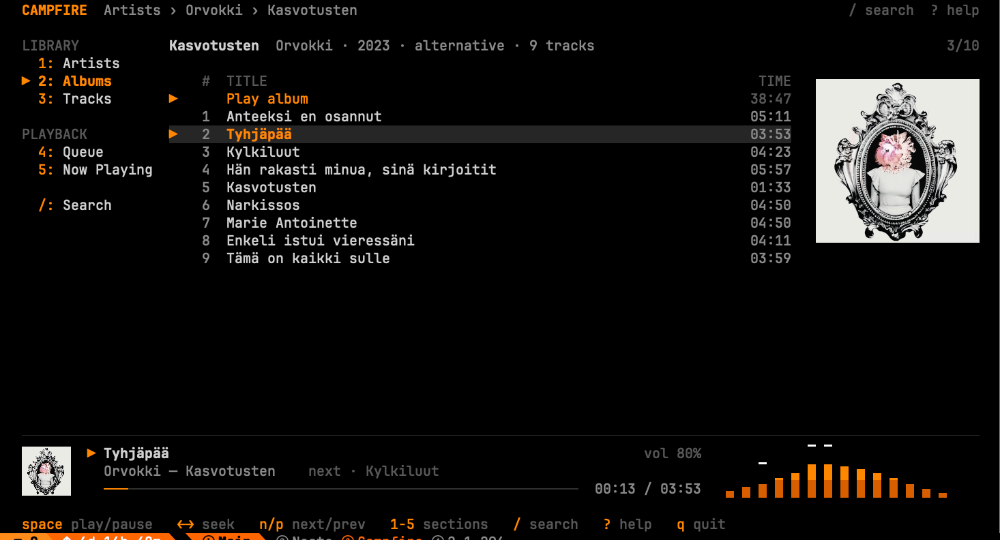
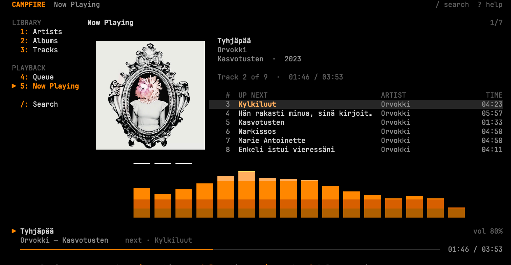

# Campfire

A terminal music player for your own Bandcamp collection. It uses Bandcamp's
official [Subsonic API](https://blog.bandcamp.com/2026/07/16/discover-improvements-and-subsonic-implementation/)
(open beta) and plays audio through [mpv](https://mpv.io).



* Browse your collection by artist, album or track. Search all three instantly.
* Play an album in order, start anywhere within it, or play everything by an artist.
* Shuffle mode, plus one-step shuffle of an album, an artist or your whole
  collection. Repeat the whole queue or one track.
* The playback queue auto-advances and skips tracks that can't be played.
* Black-and-orange default theme, plus file-based TOML themes.
* Library metadata is cached locally (SQLite) for instant startup.
* Winamp-style spectrum analyzer (or a stereo level meter), measured from the
  decoded audio, with colors you can theme.
* Album art: real images in kitty and Ghostty, colored text blocks in other
  terminals.
* No Python dependencies beyond the standard library.

## Requirements

| | |
|---|---|
| OS | macOS or Linux |
| Python | 3.11 or newer (stdlib only; `curses` must be available, which it is on standard macOS/Linux builds) |
| mpv | Required for playback (tested with 0.41). The app still starts and browses without it. |
| ffmpeg | Optional, for album art: the `ffmpeg` command-line tool decodes the images. Homebrew's mpv installs it; on Debian/Ubuntu run `sudo apt install ffmpeg`. Without it, no art is shown. |
| Terminal | Any modern terminal. 256 colors recommended; 8 colors and monochrome work. Minimum 40×10. |

Install mpv:

```sh
brew install mpv            # macOS (Homebrew)
sudo apt install mpv        # Debian / Ubuntu
sudo dnf install mpv        # Fedora (RPM Fusion)
```

## Installation

From a checkout:

```sh
git clone <repository URL> Campfire
cd Campfire
pipx install --python python3.14 .     # any Python >= 3.11
```

This installs the `campfire` command into `~/.local/bin`. If that directory
isn't on your `PATH`, run `pipx ensurepath`. Install pipx with
`brew install pipx` or `sudo apt install pipx`. To make code changes take effect
without reinstalling, use `pipx install --editable …`. To update an existing
install, run `pipx reinstall campfire`.

On macOS, plain `pip3`/`python3` are usually Apple's Python 3.9, which is too
old (the install fails with a "requires a different Python" error), and
Homebrew's Python refuses `pip install` outside a virtual environment. That's
why pipx is used here. pip fetches `setuptools` to build the package; Campfire
itself has no runtime Python dependencies.

You can also run it from the checkout without installing: `python3 -m campfire`.

## Bandcamp setup (first run)

1. Sign in at bandcamp.com and open **Settings → Fan**
   (<https://bandcamp.com/settings?pane=fan>).
2. Scroll to **Subsonic** and generate credentials. These are a separate
   username and password just for Subsonic clients, not your Bandcamp login.
3. Run:

   ```sh
   campfire login
   ```

   Paste the username and password. Campfire strips stray whitespace (the
   settings page has been known to copy a leading space), checks the
   credentials with an authenticated request, and stores them:

   * macOS: in the Keychain (service `campfire-bandcamp-subsonic`)
   * Linux: in the Secret Service keyring via `secret-tool`, if available
   * otherwise: in `~/.config/campfire/credentials.toml` with permissions `0600`

4. Start the player:

   ```sh
   campfire
   ```

   The first start downloads your collection's metadata: one album list, then
   each album's track listing. Albums appear immediately and tracks fill in as
   they load. Later starts use the cache and refresh it in the background
   once it is older than 24 hours.

To remove stored credentials, run `campfire logout`. To check your setup and
see what Bandcamp's API currently supports, run `campfire check`. It makes
read-only requests and prints no secrets.

For scripting, the environment variables `CAMPFIRE_SUBSONIC_USER` and
`CAMPFIRE_SUBSONIC_PASSWORD` override stored credentials.

## Keyboard shortcuts

Press `?` in the app for this list. These are the defaults; see
[Custom key bindings](#custom-key-bindings) to change them.

| Key | Action |
|---|---|
| `Space` | Play / pause (when stopped, restarts the current queue track) |
| `←` `→` | Seek backward / forward (10 s by default) |
| `n` / `p` | Next / previous track (`p` restarts the track after the first 3 s) |
| `s` | Stop |
| `+` / `-` | Volume up / down |
| `.` | Go to the album that is playing |
| `l` | Repeat: off → all (the whole queue) → one (the current track) |
| `z` | Shuffle mode on / off. The current track keeps playing; only the upcoming tracks are reordered, and turning it off restores their order |
| `↑` `↓` / `j` `k` | Move |
| `PgUp` `PgDn`, `g` `G`, `Home` `End` | Page, top / bottom |
| `Enter` | Open, or play from the selected track |
| `Esc` / `Backspace` / `h` | Back |
| `1` `2` `3` `4` `5` | Artists, Albums, Tracks, Queue, Now Playing |
| `/` | Search |
| `r` | Refresh the library from Bandcamp |
| `q`, `Ctrl+C` | Quit |

The section keys are shown next to each section: in the sidebar on wide
terminals, and in a tab row under the header on narrow ones.

In search, everything you type goes into the query (including `space`, `q`,
digits and letters). `↑` `↓` select a result, `Enter` opens it, `Ctrl+U` clears the
query and `Esc` returns to the previous view.

What `Enter` does:

* **Album row:** opens the album.
* **"Play album" / "Play all tracks":** starts playback in order.
* **"Shuffle album" / "Shuffle all tracks":** starts playback in random
  order and turns shuffle mode on. Tracks has a "Shuffle all tracks" row for
  your whole collection.

While shuffle mode is on, anything you start plays in random order. If you
picked a specific track, it plays first. With repeat all, each pass through
the queue gets a new order.
* **Track in an album:** plays from that track to the end of the album.
* **Track in the Tracks list or search:** a search result opens its album with
  the track selected; in the Tracks list it plays that track and the rest of
  its album.
* **Queue entry, or Up Next in Now Playing:** jumps to that track.

## Configuration

`campfire paths` prints the actual locations.

| What | Where |
|---|---|
| Settings | `~/.config/campfire/config.toml` (or `$XDG_CONFIG_HOME/campfire`) |
| User themes | `~/.config/campfire/themes/` |
| Library cache | `~/.cache/campfire/library.sqlite3` (or `$XDG_CACHE_HOME/campfire`) |

A commented `config.toml` is created on first run:

```toml
[ui]
theme = "theme_default.toml"     # file in the themes dir, or a built-in theme
visualizer = "spectrum"          # "spectrum", "meter" or "off"
spectrum_bands = 16              # 8-32
spectrum_style = "bars"          # "bars" or "segments" (LED blocks)
spectrum_peaks = true            # falling peak markers
album_art = "auto"               # "auto", "graphics", "blocks" or "off"

[playback]
seek_seconds = 10
volume = 80                      # initial volume, 0-100
previous_restart_seconds = 3.0   # "previous" restarts the track after this
repeat = "off"                   # repeat mode at startup: "off", "all" or "one"
shuffle = false                  # shuffle mode at startup
mpv_path = "mpv"
mpv_user_config = false          # load your mpv.conf and mpv scripts (see Security)

[library]
cache_max_age_hours = 24

[server]
url = "https://bandcamp.com/api/subsonic"
```

Invalid values are reported in the status line and replaced by defaults. A
broken file never stops the app from starting.

## Now Playing, album art and visualizer



Press `5` for the Now Playing view: a large cover, the track details, the
upcoming tracks (selectable with `Enter`), and a large spectrum analyzer.
Album views show the cover next to the track list. The bottom panel shows a
small spectrum when the terminal is at least 90 columns wide, and the stereo
level meter otherwise.

* **Album art** (`ui.album_art`):
  * `auto` sends real images to terminals with the kitty graphics protocol
    (kitty, Ghostty) and draws colored half-block characters elsewhere.
  * Inside tmux, real images need one tmux setting; see
    [Using tmux](#using-tmux).
  * `graphics` and `blocks` force one method; `off` disables art.
  * Art needs `ffmpeg`. Covers are cached in the cache directory.
* **Visualizer** (`ui.visualizer`):
  * The bars are real measurements. mpv splits the audio into 8–32 frequency
    bands (40 Hz–16 kHz, log-spaced) with ffmpeg band-pass filters and
    reports each band's level; Campfire adds Winamp-style falloff and peak
    markers.
  * `ui.spectrum_style = "segments"` gives LED-style blocks.
  * The colors come from the theme's `spectrum_*` entries.
  * It uses a few percent of one CPU core and nothing while paused.

## Using tmux

Campfire works in tmux as is. For **sharp album art** inside tmux (tmux 3.3 or
newer, running in kitty or Ghostty), allow tmux to pass the image data through
to the terminal:

```sh
# enable it now, and for future tmux sessions
tmux set -g allow-passthrough on
echo 'set -g allow-passthrough on' >> ~/.tmux.conf
```

Then restart Campfire. Without this setting, covers are drawn as colored text
blocks, and Campfire shows a one-time hint.

Passthrough lets any program in a tmux pane send escape sequences directly to
the outer terminal, not just Campfire (see [docs/security.md](docs/security.md)).
If you'd rather not enable it, set `ui.album_art = "blocks"` to keep text art
without the hint.

The screenshot above is Ghostty 1.3 inside tmux 3.7 with passthrough enabled.

## Custom key bindings

Add a `[keys]` table to `config.toml`. Each action takes one key or a list of
keys:

```toml
[keys]
artists = "a"
albums = ["l", "f2"]
play_pause = ["space", "f5"]
```

A key is a single character (`"n"`, `"G"` and `"g"` are different, `"1"`,
`"/"`), or one of `space`, `tab`, `left`, `right`, `insert`, `delete`,
`f1`–`f12`.

The actions and their defaults:

| Action | Default | | Action | Default |
|---|---|---|---|---|
| `play_pause` | `space` | | `artists` | `1` |
| `seek_back` | `left` | | `albums` | `2` |
| `seek_forward` | `right` | | `tracks` | `3` |
| `next` | `n` | | `queue` | `4` |
| `previous` | `p` | | `now_playing` | `5` |
| `stop` | `s` | | `search` | `/` |
| `goto_playing` | `.` | | `refresh` | `r` |
| `volume_up` | `+`, `=` | | `help` | `?` |
| `volume_down` | `-` | | `quit` | `q` |
| `repeat` | `l` | | `shuffle` | `z` |
| | | | `move_up` / `move_down` | `k` / `j` |
| `top` / `bottom` | `g` / `G` | | `back` | `h` |

The arrow keys `↑` `↓`, Page Up/Down, Home/End, Enter, Esc and Backspace always
keep their navigation meaning and can't be rebound, so you can't lock
yourself out.

The sidebar, section tabs, hint line and help screen show whatever keys are
configured. Binding a key that another action uses by default moves it to your
action, and the other action loses that key. Invalid names, reserved keys
and conflicts between your own bindings are reported in the status line, and
the defaults are used instead.

In search, printable keys always type into the query, so single-character
bindings don't fire while you type.

## Themes

Built-in themes are `theme_default.toml` (black and orange),
`theme_dracula.toml` and `theme_winamp.toml` (Winamp 2 classic: green text,
green-yellow-red spectrum). To make your own, put a file in
`~/.config/campfire/themes/` and select it with `ui.theme`:

```toml
name = "My theme"

[colors]
background     = "#000000"   # or "default" for the terminal's own background
text           = "#d0d0d0"
text_secondary = "#8a8a8a"
muted          = "#585858"
accent         = "#ff8700"
selection_fg   = "#ffaf5f"
selection_bg   = "#262626"
current_track  = "#ff8700"
progress_fill  = "#ff8700"
progress_empty = "#303030"
border         = "#262626"
error          = "#ff5f5f"
warning        = "#ffd75f"
spectrum_low   = "#af3a00"   # spectrum gradient, bottom ...
spectrum_mid   = "#ff8700"
spectrum_high  = "#ffd787"   # ... to top
spectrum_peak  = "#ffffff"   # falling peak markers
```

Any color you leave out is taken from the default theme. Colors are mapped to
the nearest of the terminal's 256 (or 8) colors. If a theme file is missing or
invalid, Campfire uses the default theme and shows a warning. Themes are plain
data and can't run code.

## Security

Campfire's security measures and their limits are described in
[docs/security.md](docs/security.md). In short:

* Credentials are kept in the system keyring (or a `0600` file).
* All traffic uses verified TLS.
* Stream URLs contain an auth token, so they are never cached, logged or put
  on a command line.
* mpv runs without your `mpv.conf` and scripts by default, because scripts can
  read the current URL.
* If you think a URL or your credentials have leaked, regenerate the Subsonic
  credentials in Bandcamp's Fan Settings and run `campfire login`.

If you need your own mpv settings (for example a specific audio device), set
`playback.mpv_user_config = true` in `config.toml`. Only do this if you trust
every script in your mpv scripts folder.

## Running the tests

```sh
python3 -m unittest
```

The automated tests mock all network and mpv interaction and need no
credentials, network access or audio device. They cover configuration, themes,
model parsing, the API client's error handling, library search and
pagination, the cache, the queue, the playback controller's state machine, and
UI layout logic.

### Manual verification

These are not automated:

1. `campfire check` reports what Bandcamp's API supports for your account.
2. `campfire`: play an album, pause/resume, seek, next/previous, let a
   track end and check that the next one starts, quit with `q` and with
   `Ctrl+C`, and confirm the terminal is restored.
3. Resize the terminal while running, down to below 40×10.

## Troubleshooting

| Problem | Fix |
|---|---|
| "Bandcamp rejected the Subsonic credentials" | Regenerate them in Fan Settings → Subsonic and run `campfire login` again. Bandcamp's beta answers bad credentials with an empty HTTP 500, so this message can also appear during a Bandcamp outage. |
| "mpv not found" | Install mpv, or set `playback.mpv_path` to its full path. |
| "Could not reach Bandcamp" | Check your network. The cached library stays browsable. |
| A track won't play | Campfire shows mpv's error and moves on. After three failures in a row it stops. |
| "This stream does not support seeking" | mpv reported the stream as not seekable. |
| Wrong or ugly colors | Use a 256-color terminal (`TERM=xterm-256color`), or try `background = "default"` in a theme. |
| Stale library | Press `r`, or delete the cache file shown by `campfire paths`. |

## Known limitations

* Bandcamp's Subsonic API is a beta. Behavior described in
  [docs/technical-plan.md](docs/technical-plan.md) may change.
* The first sync makes one request per album (4 run in parallel). A small
  collection syncs in a couple of seconds; very large collections have not been
  tested and will take longer. Bandcamp itself warns the beta can be slow with big collections.
* Streams are whatever Bandcamp's Subsonic `stream` endpoint serves (MP3 from
  Bandcamp's CDN). There is no offline download.
* Playlists, scrobbling and gapless playback are not implemented.
* Artists are grouped by name, so two different artists with the same name
  are shown together.
* The visualizer needs mpv built with libavfilter (standard builds have it). If
  its filter ever can't process a track, Campfire turns the visualizer off
  and plays the track anyway. It runs slightly ahead of what you hear (by the
  audio output buffer). There is no oscilloscope mode, because mpv doesn't
  expose raw samples.
* Text-block album art is coarse: 2 pixels per character cell, 256 colors.
  Real images need the kitty graphics protocol with Unicode placeholders
  (kitty, Ghostty). In tmux they also need `allow-passthrough on`; GNU screen
  is not supported.
* Windows is not supported (curses, Unix sockets).
